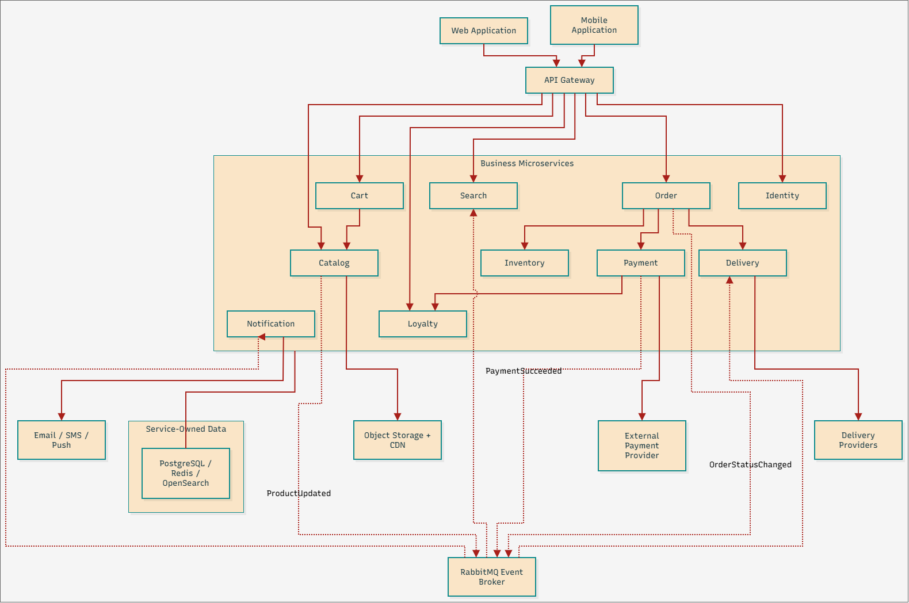
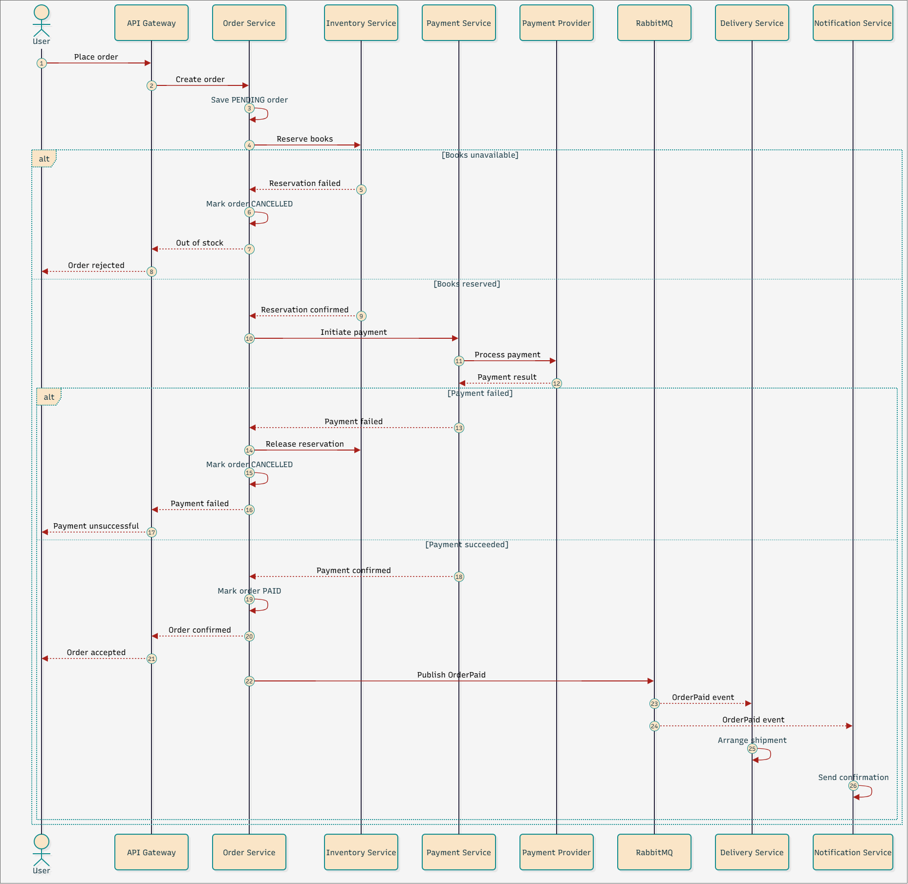

# Учебная микросервисная архитектура интернет-магазина «Читай-город»

## 1. Функциональные требования

- Регистрация и авторизация пользователей.
- Просмотр каталога книг.
- Поиск и фильтрация товаров.
- Просмотр карточек товаров.
- Управление корзиной.
- Оформление заказов.
- Проверка наличия и резервирование книг.
- Онлайн-оплата и возвраты.
- Доставка и самовывоз.
- Просмотр истории заказов.
- Работа с бонусной программой.
- Отправка уведомлений.

## 2. Нефункциональные требования

- Доступность системы - 99,9%.
- Время ответа каталога - p95 до 300 мс.
- Время ответа поиска - p95 до 500 мс.
- Поддержка пиковых нагрузок до 5 средних.
- Независимое масштабирование микросервисов.
- Отказоустойчивость и сохранность данных.
- Защищённое взаимодействие компонентов.
- Централизованные логи, метрики и трассировка.

P.S. Представленные значения - просто гипотетические проектные цели.

## 3. Декомпозиция на микросервисы

| Сервис | Ответственность |
|---|---|
| Identity Service | Авторизация и пользователи |
| Catalog Service | Книги, категории, цены |
| Search Service | Поиск и фильтрация |
| Cart Service | Корзина |
| Order Service | Создание заказов и статусы |
| Inventory Service | Остатки и резервирование |
| Payment Service | Оплата и возвраты |
| Delivery Service | Доставка и самовывоз |
| Loyalty Service | Бонусная программа |
| Notification Service | Уведомления |

## 4. Оценка нагрузки

P.S. Данные, опять же, гипотетические.

- 1 000 000 зарегистрированных пользователей.
- 100 000 активных пользователей в сутки.
- 20 просмотров каталога в день на пользователя.
- 5 поисковых запросов в день на пользователя.
- 2 000 заказов в сутки.
- Пиковая нагрузка в 5 раз выше средней.

| Операция | Запросов в день | Средний RPS | Пиковый RPS |
|---|---:|---:|---:|
| Каталог | 2 000 000 | 23,1 | 116 |
| Поиск | 500 000 | 5,8 | 29 |
| Создание заказа | 2 000 | 0,023 | 0,12 |

Формула расчёта:

`RPS = количество запросов в сутки / 86400`

## 5. Оценка объёма данных

| Категория | Оценка |
|---|---:|
| Каталог (1 млн товаров) | 3 ГБ |
| Изображения обложек | 200 ГБ |
| История заказов за 3 года | 4,4 ГБ |
| Пользовательские профили | 1 ГБ |
| **Итого** | **208,4 ГБ** |

## 6. Архитектурные решения

Используем следующие паттерны:

- **API Gateway** - единая точка входа для веб-сайта и мобильного приложения.
- **Database per Service** - логическое разделение данных микросервисов.
- **Event-Driven Architecture** - обмен событиями через RabbitMQ.
- **Saga** - координация резервирования и оплаты заказов.
- **CQRS** - отдельная поисковая модель, обновляемая из каталога.
- **Cache-Aside** - кэширование популярных товаров.

Предполагаемый технологический стек: PostgreSQL, Redis, OpenSearch, RabbitMQ, Object Storage, CDN и Kubernetes.

## 7. Архитектурные диаграммы

### High-Level Architecture

Общая схема системы.

### Order Processing - Sequence Diagram

Диаграмма последовательности оформления заказа, демонстрирующая взаимодействие микросервисов.

Диаграммы сделаны в diagrams.net.